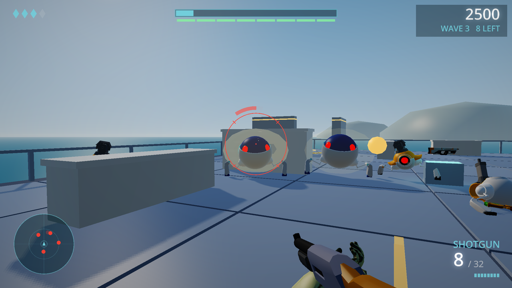

<p align="center">
  
</p>

<h1 align="center">sloppy</h1>

<p align="center"><b>a simple game dev language</b></p>

<p align="center">
  <a href="https://github.com/david-andrew/sloppy-lang/releases/latest"></a>
  <a href="https://github.com/david-andrew/sloppy-lang/actions/workflows/test.yml"></a>
  <a href="https://sloppy-lang.org/"></a>
  <a href="https://sloppy-lang.org/playground/"></a>
  
  <a href="LICENSE"></a>
</p>

Sloppy is a small, compiled, statically typed language that feels like a scripting language,
built for making games. `sloppy game.jo` compiles the whole program and runs it in a blink;
`sloppy build game.jo` writes a standalone executable for Linux, macOS or Windows, and with
`target = wasm` a single self-contained `.html` file that runs in a browser straight from disk.

```gdscript
# hello.jo
print("hello, world")

fib = (n: int) -> int:
    if n < 2: return n
    fib(n - 1) + fib(n - 2)

nums = [5 3 9 1]
nums.sort()
squares = nums.map((x): x * x)
add = (a: int, b: int): a + b
print(squares, add(1, _)(41), fib(30))
print(nums .* 2.5 .+ 1, sqrt.([4.0 9.0]), [1 2; 3 4] * [1 0; 0 1])
```

A complete (tiny) game:

```gdscript
pos = vec2(400, 300)

update = (dt: f64):
    dir = vec2(0, 0)
    if key_down(.left): dir.x -= 1
    if key_down(.right): dir.x += 1
    if key_down(.up): dir.y -= 1
    if key_down(.down): dir.y += 1
    pos += dir * 300 * dt

draw = ():
    clear(rgb(0.08, 0.08, 0.12))
    circle(pos, 24, rgb(1.0, 0.6, 0.2))
    text("arrow keys", vec2(20, 20), 24, rgb(1, 1, 1))
```

A complete one: [Rebound](examples/rebound/rebound.jo), an arcade game in one file. Turn a
shield around the core to catch the turrets' bolts and send them back: blasts set off the
turrets beside them, catches near the shield's edge bank off to other turrets, and every few
turrets you choose an upgrade. [Play it in the browser](https://sloppy-lang.org/rebound/), or
change it there in [the playground](https://sloppy-lang.org/playground/#example=rebound).

<p align="center"><a href="https://sloppy-lang.org/rebound/"></a></p>

In 3D: [Breakwater](examples/breakwater/breakwater.jo), a first-person shooter in one file. Hold a
platform at sea against waves of robots, with a shield that recharges, two weapons at a time,
grenades and melee; animated glTF models, shadows and bloom. [Play it in the
browser](https://sloppy-lang.org/breakwater/).

<p align="center"><a href="https://sloppy-lang.org/breakwater/"></a></p>

## Highlights

- **Fast compiles.** About 250,000 lines per second on one core (debug builds), roughly 20x
  faster than `gcc -O0`. Hello world compiles and runs in ~10 ms. There are no incremental
  builds and no build system: build options live in the source (`build:` block).
- **Edit while it runs.** `sloppy watch game.jo` reloads the running game as you save: new code
  takes over between two frames, and the game keeps its state, its window and what it loaded.
- **Fast programs.** Release builds (`opt = release`) are within ~1.5x of `gcc -O2` on the
  benchmark set (geometric mean), with bounds checks kept on. `parallel_map` and friends use
  every core.
- **Easy.** Type inference everywhere, Python-like indentation syntax, first-class functions
  (`f = (x: int): x * 2`), closures, partial application (`f(1, _)`), generics without
  ceremony (untyped parameters), uniform call syntax (`x.f(y)` is `f(x, y)`), one `loop` for
  every kind of loop, type unions (`int | ParseError`) with `is`, errors as values passed on
  with `?` (`n = parse(s)?`), optionals, pattern matching (`match`, `if let .bin(op, l, r) =
  e:`), recursive types (`struct Node: next: Node?`), maps and sets (`{"a": 1}`, `{1, 2}`), unit
  literals (`120ms`, `1.2(m/s)`).
- **Numeric arrays.** numpy-style elementwise operators that broadcast (`a .* b .+ 1`,
  `f.(xs)`) and compile to one fused loop, 2-D arrays (`[1 2; 3 4]`, matrix products),
  `zeros`/`linspace`/`rand`..., struct-of-arrays storage (`soa Particle[]`), and GPU arrays
  (`gpu(xs)`): the same dotted expressions on them compile to a GPU program. For more control,
  buffers of any struct on the GPU and compute functions written in Sloppy (`dispatch`, atomics,
  indirect draws).
- **Predictable.** Plain value semantics: arrays, strings and maps are reference counted with
  copy-on-write, so there is no garbage collector, no reference cycles and no hidden aliasing.
- **Batteries for games.** Windows and input, 2D drawing with SDF text, a 3D renderer with
  sun/sky lighting, shadows, fog and bloom (glTF models, orbit and fly cameras), GPU programs written in Sloppy itself (compiled to
  SPIR-V for Vulkan and to GLSL for OpenGL and WebGL), PNG, JPEG, WAV, Ogg Vorbis and TrueType loading, sprite sheets and tilemaps (Aseprite,
  Tiled), a software audio mixer and synthesizer.
- **Multiplayer with no server.** Invite a friend with a link (`import invite`, or
  `sloppy new my_game online`): they open it, the game in their browser, and the two games
  connect straight to each other, browser or desktop, anywhere (WebRTC: the browser's own in a
  page, Sloppy's own in native programs; a TURN relay for strict networks if you have one).
  Rooms with a short code through a small matchmaking server of your own
  ([docs/MATCHMAKING.md](docs/MATCHMAKING.md)). Rollback netplay (`netplay.session`) for fighting
  and action games, client and server for many players. See [playing over a network](docs/MULTIPLAYER.md), [Duel](https://sloppy-lang.org/examples/duel/)
  and [Aces](https://sloppy-lang.org/examples/aces/) (biplanes in a dogfight, up to six a side).
- **Scripts, tools and servers.** `net.fetch` for http and https (TLS 1.3 and 1.2, Sloppy's own,
  checked against the system's certificates), an HTTP server (`import http`: routes, files,
  cookies, WebSockets), JSON into structs (`from_json[Config](text)`), command-line options from
  a struct (`parse_args[Options]("what it does")`), files, processes and regular expressions; see
  [Scripts and tools](docs/START.md#scripts-and-tools).
- **Programs keep working.** Native executables are static (they talk to the kernel directly);
  the GPU driver is loaded at run time when present, and without one games still run on a
  multithreaded software renderer. Web builds are one HTML file with the WebAssembly embedded. The compiler needs no assembler, linker or C toolchain.
- **Self-hosted.** The compiler is written in Sloppy (~15k lines) and compiles itself; a small
  C compiler in `stage0/` bootstraps it.

## Getting started

Install on Linux (x86-64 or arm64) or macOS (Apple Silicon), in a terminal (into `~/.sloppy`, with the command on your PATH, in most setups at once; `sloppy upgrade` installs newer releases):

```sh
curl -fsSL https://sloppy-lang.org/install | bash
```

On Windows (10 or 11, x64; into `%LOCALAPPDATA%\sloppy`, added to your PATH), in PowerShell:

```powershell
irm https://sloppy-lang.org/install.ps1 | iex
```

Or try it in the browser: [the playground](https://sloppy-lang.org/playground/). Then
[make a game](docs/TUTORIAL.md): a small platformer, built step by step; then
[an arcade game](docs/TUTORIAL_REBOUND.md), a small version of Rebound; then
[a 3D shooter](docs/TUTORIAL_BREAKWATER.md), a small version of Breakwater.

From source:

Requirements: Linux x86-64; a C compiler is needed once, to build the bootstrap compiler.

```sh
tools/bootstrap.sh            # stage0 (C) -> sloppy1 -> sloppy2 -> sloppy3, checks sloppy2 == sloppy3, installs bin/sloppy
bin/sloppy                       # an interactive prompt
bin/sloppy examples/shapes.jo   # compile and run
bin/sloppy examples/rebound/rebound.jo      # a complete 2D arcade game (menus, upgrades, a saved best)
bin/sloppy examples/breakwater/breakwater.jo   # a complete 3D first-person shooter
bin/sloppy examples/dunes/dunes.jo          # a smaller 3D game
bin/sloppy watch examples/rebound/rebound.jo    # ... reloaded as you edit it (try its tuning constants)
bin/sloppy --web examples/dunes/dunes.jo    # the same game in the browser
bin/sloppy build examples/dunes/dunes.jo --target wasm -o dunes.html   # a page to keep or share
bin/sloppy test tests/unit/sample_test.jo  # run `test` blocks
bin/sloppy check file.jo        # type check only
bin/sloppy fmt compiler lib     # lay out the code (the tests check these are laid out so)
```

`bin/sloppy` finds the standard library in `lib/` next to its own directory (or `$SLOPPY_LIB`).
Working on the compiler itself: [docs/COMPILER.md](docs/COMPILER.md).

**In the browser:** `tools/playground.py` builds `build/playground.html`, one self-contained
page (1.4 MB) with an editor, examples and the Sloppy compiler itself, compiled to WebAssembly:
programs (games included) compile in the page in well under 100 ms and run beside the editor.
Share links carry the program in the address.

## Editors

`sloppy lsp` is a language server (the Language Server Protocol, on standard input and output):
errors as you type, hover with types and doc comments, go to definition, references, rename,
completion, signature help, inlay hints for inferred types, and an outline. It is the compiler
itself answering, so it agrees with the compiler by construction.

VS Code, Cursor and VSCodium: the [Sloppy extension](https://marketplace.visualstudio.com/items?itemName=RedFoxLabs.sloppy)
(also [on Open VSX](https://open-vsx.org/extension/RedFoxLabs/sloppy)): highlighting, the language
server, and commands to run a file in a terminal or the browser, or its tests.
`code --install-extension RedFoxLabs.sloppy` installs it. Its source is `editors/vscode`;
`tools/vsix.py` packages it (`build/sloppy-<version>.vsix`).

Other editors: run `sloppy lsp` for `*.jo` files. For example, Neovim (0.11):

```lua
vim.lsp.config('sloppy', { cmd = { 'sloppy', 'lsp' }, filetypes = { 'sloppy' }, root_markers = { '.git' } })
vim.lsp.enable('sloppy')
vim.filetype.add({ extension = { jo = 'sloppy' } })
```

and Helix (`languages.toml`):

```toml
[language-server.sloppy]
command = "sloppy"
args = ["lsp"]

[[language]]
name = "sloppy"
scope = "source.sloppy"
file-types = ["jo"]
comment-token = "#"
indent = { tab-width = 4, unit = "    " }
language-servers = ["sloppy"]
```

## Documentation

The website (built by `tools/site.py`, published by `.github/workflows/site.yml`) has these
pages and the playground.

- [docs/START.md](docs/START.md) — getting started: installing, a first program and game, sharing it
- [docs/LANGUAGE.md](docs/LANGUAGE.md) — the language
- [docs/API.md](docs/API.md) — the library, by topic, each with an example (generated from `lib/` and `docs/api/`)
- [docs/CONTESTS.md](docs/CONTESTS.md) — contests and Advent of Code: input, integers, containers, binary search, number theory
- [docs/REPORT.md](docs/REPORT.md) — measured results for the design goals (`tools/report.py`)

## Repository layout

```
compiler/      the Sloppy compiler, in Sloppy
  lex, parse, ast        source -> syntax tree
  check, expr, types     name resolution, type inference, overloading, generics
  lower                  syntax tree -> IR (register based, structured control flow)
  opt, inline            release builds: folding, CSE, check elimination, inlining
  x64, elf               IR -> x86-64 machine code -> static ELF executable
  arm64                  IR -> arm64 machine code (Linux on 64-bit ARM, macOS)
  macho                  Mach-O executables for macOS: dyld's binds, an ad hoc code signature
  wasm                   IR -> WebAssembly, packaged into one HTML file
  spirv                  shader functions written in Sloppy -> SPIR-V (Vulkan)
  glsl                   shader functions written in Sloppy -> GLSL ES 3.00 (OpenGL, WebGL)
  ide, lsp               the language server (sloppy lsp): what the checker learns, for editors
  repl                   the interactive prompt: compiles each input against a live session
stage0/        bootstrap compiler in C (compiles compiler/ once)
lib/core/      runtime, strings, arrays, maps, math, files, formatting
lib/std/       thread pool and parallel helpers, numeric arrays (nd.jo)
lib/game/      windows (Wayland, X11, Win32, Cocoa), input, Vulkan, OpenGL ES / WebGL, 2D, 3D, images, audio
lib/web/       JavaScript glue embedded into web builds
editors/       the VS Code extension (tools/vsix.py packages it)
examples/      rebound (a complete 2D game), breakwater (a complete 3D game), dunes (3D), aces, duel and netpong (over the network), arena (a server), tiles (a tilemap and sprites), shapes, cube, scene3d
tests/         test programs with expected output (tools/runtests.py), render references
bench/         benchmarks (Sloppy and equivalent C)
tools/         bootstrap, test runner, render test, differential fuzzer, language server test,
               headless GNOME screenshots (gnomeshot.py), the web playground (playground.py,
               playground/), the website (site.py, site/), report, profiler, instruction counter
```

Testing: `tools/runtests.py` runs the test programs in each mode (native/web, debug/release,
and with the C bootstrap compiler); `tools/rendertest.py` checks software-rendered frames
against references; `tools/fuzz.py` generates random programs and compares five builds of
each — native and web, debug and release, and the independent C bootstrap compiler, which
catches mistakes the four self-hosted builds would share; `tools/gpufuzz.py` does the same for
code that runs on the GPU (the CPU, SPIR-V on two drivers, and GLSL must agree).

## How it works

The compiler parses and type-checks the whole program (the standard library is always
included and only what is used gets compiled), lowers it to a compact IR, and generates
machine code directly: a linear-scan register allocator and an x86-64 encoder write the ELF
file in one pass. Release builds additionally run an IR optimizer — constant folding, copy
propagation, common-subexpression and redundant-load elimination keyed by memory class,
bounds-check and copy-on-write-check elimination, inlining of small functions, and folding of
array indexing into x86 addressing modes.

Windows programs (`--target windows`, the default on Windows) are PE executables that import
only what finds everything else (LoadLibraryA, GetProcAddress and three more from kernel32.dll):
the rest of Windows is looked up as it is first used, as C libraries are on Linux. Games open a
Win32 window and draw with Vulkan, or with OpenGL through WGL (a core 4.3 context takes the
GLSL shaders), or with the software renderer; gamepads are XInput's, sound goes through waveOut.

macOS programs (`--target macos`, the default on a Mac; Apple Silicon) are Mach-O executables
the compiler writes itself, with an ad hoc code signature, so they can be made on Linux too.
They are dynamically linked, as macOS requires: dyld binds the C functions they use when they
start, and the library's system calls are made through libSystem's functions. Games open a
Cocoa window through the Objective-C runtime and draw with OpenGL 4.1 (the shaders as GLSL
4.10) or with the software renderer; sound goes through AudioQueue.

On Linux, native programs are static executables that make system calls directly. Programs that
open a window load the system's libraries for it at run time with a tiny in-process loader (the
static binary maps the system dynamic linker and asks it for the libraries): libwayland-client
and libdecor in a Wayland session (so windows get the desktop's own decorations; frames are
rendered with EGL into an offscreen buffer shared with the compositor), otherwise X11; and
Vulkan, or EGL and OpenGL ES. Nothing is loaded at all by programs that do not use graphics, and a missing
library is a run-time decision instead of a load-time failure: without a Vulkan 1.3 driver games
draw with OpenGL ES, and without that either (or with `SLOPPY_SOFTWARE=1`) they draw with a software renderer (`lib/game/softgl.jo`) that
runs the Sloppy shader functions on the CPU in parallel, at half resolution; without
libwayland-client or libX11 the window is opened by speaking the Wayland or X11 protocol over
the socket (`lib/game/wayland.jo`, `lib/game/x11.jo`), and without libdecor the program
draws its own title bar. The
software frames match the GPU's within about 1/255 per channel (`tools/rendertest.py` checks
them against references, with no GPU or display needed).

With Vulkan (`lib/game/vk.jo`, in the style of [mr_gpu](https://codeberg.org/games-by-Mason/mr_gpu))
the GPU work is laid out the way current GPUs like it: one device with dynamic rendering and
synchronization2, every texture in one bindless array, buffers read by their device addresses
(vertices are fetched by the vertex shader; there is no vertex input state), a frame's data
written into per-frame upload memory, device memory in a few large blocks. The compiler
translates the same shader functions to SPIR-V itself (`compiler/spirv.jo`), so no shader
compiler is needed either. The library's GL calls become Vulkan calls (`lib/game/vkgl.jo`):
frames come out the same through either (`tools/vkcompare.py`, and the render tests through
Vulkan, in CI too on Mesa's software driver). `SLOPPY_VULKAN=0` uses OpenGL. Programs can use
that machinery directly (`lib/game/gpubuffer.jo`): a `GpuBuffer[T]` is a buffer read by its
address, a compute function a compute program, `draw_indirect` an indirect draw, with the
barriers between them made automatically. Without Vulkan the same buffers are CPU memory and
compute functions run on the CPU, so such programs run everywhere.

The web backend emits WebAssembly from the same IR; the HTML file contains the module (base64)
and a small JavaScript runtime for WebGL 2, input and audio.

## License

MIT (see [LICENSE](LICENSE) and [NOTICE](NOTICE)), so programs built with Sloppy, which include its runtime and
library, can be released under any license. The logo is not covered by it; the default font
is Noto Sans, under the SIL Open Font License ([lib/game/assets/OFL.txt](lib/game/assets/OFL.txt)).
