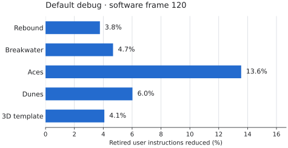

# Whole-vector instruction counts

These kernels measure f32 vec3/vec4 and column-major mat4 math, alongside a C
counterpart compiled with `cc -O2 -ffp-contract=off -lm`. There is no fast math,
`restrict`, architecture tuning, or explicit intrinsics in C. Sloppy uses
`--release`, one emission worker, and `SLOPPY_NO_AVX=1`. The x86-64 packing uses
only SSE2, independently of the existing AVX2 runtime check for array loops.

Run from the repository root, under the machine's shared test-worker budget:

```
TMPDIR=$HOME/dev/tmp/simd/tmp python3 bench/vmath/measure.py \
    --compiler bin/sloppy --label after
```

Use a different output label from the compiler filename. The script builds an
exact-count copy of `tools/icount.c` in `~/dev/tmp/simd`, compiles both languages,
and records three hardware-counter samples of whole-process retired user
instructions per mode. It checks that printed results round to identical f32
bits. Initialization and output are included. No wall-clock measurements are
used. `measurements.json` retains the raw samples.

Every kernel processes 1,024 elements, repeated 256 times. The modes cover
vec4 add/multiply/dot/lerp/normalize, matrix-vector and matrix-matrix multiply,
vec3 cross/normalize, and an update of particle positions and velocities.
`vertex` executes the cube example's CPU vertex shader and calls the actual
`__sw_project` from `lib/game/softgl.jo`, with ten varying floats and no flat
integer attributes. This measures a shader plus the renderer's real projection
stage; it does not claim to measure the full renderer or a physics simulation.
The C version uses the same shader and a translation of that projection stage.

## Design and numerical behavior

SRA and inlining still run unchanged. Immediately before x86-64 or ARM64 register
allocation, a bounded pass recovers small expression trees from adjacent f32
lane stores and ordered sums of products. It uses the existing VX register
allocator on x86-64 and the FP/SIMD allocator on ARM64, `vbin`, and `vsplat`, with unary kinds for lane extraction/shuffles,
square root and absolute value. Matrix multiplication consequently becomes
four scalar broadcasts, packed products, and left-associated packed additions
per result column. Scalar work with individual users remains available.

The pass never reassociates floating-point additions and never introduces FMA,
`dpps`, or a pairwise horizontal sum. A dot multiplies packed lanes, then adds
extracted lanes in debug's original left-to-right order. This deliberately
keeps cancellation and rounding the same, at the cost of several shuffles.
Library min/max choose the second operand on equality or an unordered
comparison; SSE operand order is retained and NEON uses an ordered comparison
and bit selection instead of hardware `fmin`/`fmax`. Library `abs` means conditional
negation (`x < 0 ? -x : x`), so its packed form preserves negative zero and
NaN sign rather than simply clearing sign bits. Explicit bit-absolute-value
IR retains its existing meaning.

Vec3 stays 12 bytes in arrays, structures, parameters and return values.
A packed load uses a 64-bit load plus a 32-bit load and shuffle; its fourth
lane is zero, and a three-lane reduction extracts exactly three lanes.
Stores write exactly 12 bytes. No padding is added to the ABI. The extra
instructions can outweigh packing's gain for short vec3 trees, so these retain
scalar code. The same profitability rule covers vec2.

Packing moves loads only across straight-line code without writes or calls.
Raw pointer stores, aggregate copies (including `M_BITS`), register redefinitions
and control flow end that region. A no-return panic guard may be crossed on
its continuing path, with the guard and diagnostic kept in place. Cached packed
values are discarded at control-flow joins. Searches are bounded to functions of at most 2,048 IR instructions, depth 12,
96 nodes per root, and at most 64 memoized groups retained between roots. Large,
branch-heavy functions retain the existing code generation; their smaller math
helpers remain eligible. This bound protects the 1% release compile-cost gate. Debug and `--release -g` bypass this packing pass.

## Remaining work and targets

Both x86-64 SSE2 and ARM64 NEON are implemented, including Linux ARM64 and
Apple Silicon Mach-O output. NEON uses separate `.4s` add/subtract/multiply/divide,
square root, absolute value and negation, `dup` broadcasts/lane extraction, and
ordered compare/select for the library's min/max/conditional abs semantics.
Matrix multiplication and lerp never use fused `fmla`: ARM64 debug also emits
separate multiply and add, so contraction would change rounding.

VX values share ARM64's scalar FP register pool, with full q-register moves and
loads/stores. Scalar spills retain reusable 8-byte slots; vector spills use a
separate pool of reusable, 16-byte aligned slots. AAPCS64 preserves only d8-d15,
so VX intervals crossing ordinary calls spill all 128 bits. A function using
q8-q15 still saves/restores the low 64 bits required by the ABI. Guarded refcount
calls already preserve every q register through their existing full-save stub.
Packed memory accesses write/read exactly 8/12/16 bytes; the 12-byte case uses
`ldr/str d` plus `ld1/st1` for lane 2 and never accesses the next object.
The same bounded packing and profitability rules apply on both targets; short
vec2/vec3 expressions remain scalar. Wasm SIMD128 remains out of scope.

Packed SSE narrows the gap; it does not remove all of it. Pointer induction,
register copies, matrix helper call/ABI overhead, conservative alias barriers,
and the original scalar ordering of reductions remain opportunities. C may
vectorize across successive structures while this pass packs within one value.

## Measured results

Measured 2026-11-11 on the shared Intel Core i7-6700 desktop (hostname
`redfox`), against `dc0099db8ab8a105a2db1e5d94618acf9aa2b4c3`. C and Sloppy
use identical inputs and f32 evaluation order. All printed outputs match C
after rounding to f32. Before and after use the same measurement environment.

| Kernel | Before | After | C -O2 | After / C | Change |
| --- | ---: | ---: | ---: | ---: | ---: |
| vec4 add | 4,878,298 | 3,043,284 | 2,049,472 | 1.485 | -37.62% |
| vec4 multiply | 4,894,461 | 3,059,448 | 2,058,956 | 1.486 | -37.49% |
| vec4 dot | 5,697,163 | 5,435,014 | 7,314,858 | 0.743 | -4.60% |
| vec4 lerp | 8,053,943 | 4,908,210 | 2,601,850 | 1.886 | -39.06% |
| vec4 normalize | 10,945,223 | 9,109,185 | 6,281,073 | 1.450 | -16.77% |
| mat4 × vec4 | 15,926,854 | 10,421,824 | 5,237,002 | 1.990 | -34.56% |
| mat4 × mat4 | 68,809,881 | 46,789,776 | 27,463,122 | 1.704 | -32.00% |
| vec3 cross | 7,229,032 | 7,229,028 | 7,550,929 | 0.957 | unchanged |
| vec3 normalize | 9,839,550 | 9,839,545 | 7,552,072 | 1.303 | unchanged |
| Particles | 12,264,421 | 6,235,103 | 3,403,041 | 1.832 | -49.16% |
| Vertex shader + projection | 100,309,518 | 89,299,462 | 59,450,294 | 1.502 | -10.98% |

The real vertex workload clears the 10% gain gate: two calls to the matrix-vector
helper each save 21 instructions per vertex. That branch-free helper shrinks
from 61 instructions to 40, giving 42 fewer per vertex and 11,010,048 fewer
over 262,144 vertices, apart from startup variation. Matrix-matrix multiplication
saves the same 21 instructions for each of four result columns.

The checked-fast vec4 add/multiply loop shrinks from 17 instructions to 10:
four scalar loads, four scalar memory-operand arithmetic instructions and four
scalar stores become two packed loads, a register copy, one packed arithmetic
instruction and one packed store. Address calculation and loop control still
take five instructions; C takes seven instructions per vector in total.
Lerp falls from 29 to 17 instructions per vector and particles from 45 to 22.
Dot falls only from 20 to 19: preserving the scalar sum requires three shuffles
and three scalar adds. Short vec3 cross/normalize stay scalar, where the
extra packing cost would not pay. Initialization and whole-process startup
explain the remaining differences from these exact hot-loop deltas.

## ARM64 NEON measurements

Measured 2026-11-11 with QEMU 11.0.3 on the shared desktop (`redfox`), against
`90e7dafcabe426c9a15cd70d89e813757fd8a83f`. These are **executed ARM64 guest
instructions**, counted by `insn.c` through QEMU's plugin API; host `perf` counts
would measure QEMU itself. Each translated block contributes its instruction
count every time it executes. These kernels have no mid-block faults. Counts
include initialization and output, using the same 1,024 elements × 256 repeats.
All before/after printed outputs match exactly, including the recorded x86-64
outputs. Both versions run from the same filename so argument scanning contributes
identical startup work. These are instruction counts, not Apple Silicon timing; real macOS measurements remain for the CI runner.
Raw counts and compiler hashes are in `arm64-measurements.json`.

```
TMPDIR=$HOME/dev/tmp/neon/tmp python3 bench/vmath/measure_arm64.py \
    --before $HOME/dev/tmp/neon/sloppy-before --after bin/sloppy \
    --plugin-include $HOME/.pixi/envs/cross/include/qemu-aarch64
```

Build the before compiler from the starting revision's sources. The QEMU header
must match the executable's plugin API version. `cc` and `pkg-config` with native
GLib development headers are needed to build the small plugin. If necessary,
point `PKG_CONFIG_PATH` at the installed GLib and PCRE2 `.pc` directories.

| Kernel | Before | NEON | Change |
| --- | ---: | ---: | ---: |
| vec4 add | 8,896,098 | 3,391,074 | -61.88% |
| vec4 multiply | 8,909,299 | 3,404,275 | -61.79% |
| vec4 dot | 9,708,036 | 5,513,732 | -43.20% |
| vec4 lerp | 12,063,981 | 4,461,805 | -63.02% |
| vec4 normalize | 16,523,634 | 12,329,330 | -25.38% |
| mat4 × vec4 | 17,836,133 | 8,661,093 | -51.44% |
| mat4 × mat4 | 106,751,385 | 54,322,585 | -49.11% |
| vec3 cross | 8,883,465 | 8,883,465 | unchanged |
| vec3 normalize | 18,307,897 | 18,307,897 | unchanged |
| Particles | 20,462,959 | 6,307,183 | -69.18% |
| Vertex shader + projection | 134,134,206 | 117,356,990 | -12.51% |

The branch-free matrix-vector helper shrinks from 58 instructions to 26; the
vertex workload calls it twice per vertex, saving 64 instructions per vertex
(16,777,216 across 262,144 vertices), exactly the measured whole-process delta.
Dot retains separate scalar adds in the original order. Vec3 cross and normalize retain scalar code.

## Original x86-64 validation

- Bootstrap: `bootstrap ok`, self-compilation is a fixed point. A scratch copy
  of `tools/bootstrap.sh` redirects its hardcoded `/tmp` paths to `$TMPDIR`.
- `python3 tools/runtests.py`: 27 passed, 0 failed.
- `python3 tools/runtests.py --compiler sloppy`: 1212 passed, 0 failed.
- `python3 tools/runtests.py --compiler sloppy --release`: 1206 passed, 0 failed.
- ARM64 release under `qemu-aarch64`, new `simd_` tests: 1 passed, 0 failed.
- `python3 tools/rendertest.py --no-gpu`: 35 passed, 0 failed.
- `tools/speedcheck.py --base dc0099db8ab8a105a2db1e5d94618acf9aa2b4c3`:
  maximum regression 0.03%; with `--release`,
  0.96%, below the 1% limit. Raw compile counts are in
  `measurements.json`.

Native test suites run one at a time in a private user/network namespace with
the normal user ID preserved and loopback enabled, avoiding other agents' fixed-port servers on this shared
machine. All compilation uses one emission worker; the run holds one of the
machine-wide test-worker locks. No display or audio output is enabled.

`tests/t/simd_values.jo` checks all operators, broadcasts, dot cancellation,
NaNs/infinities/signed zero, conditional-abs signs, vec3's unused lane, unaligned
byte storage, overlapping raw pointers, joins, structures/arrays and matrix
inverse/transpose. Its expected output comes from the unchanged baseline's debug
compiler. The full suites include all `value_copy_*` and `aggregate_copy_alias`.
The final expanded fixture was also rerun separately in debug, release and ARM64 release.
An initial debug simulation timeout passed on retry; its generated `.text` is
byte-identical to the baseline, and the final complete debug run passes.

Shared compiler files touched: `ir.jo`, `opt.jo` (new vector pass and operand
classification) and `x64.jo`. SRA itself, `lower.jo`, `inline.jo`, `main.jo`,
`par.jo`, `arm64.jo`, the library and all examples are unchanged.


## NEON validation

- `tools/bootstrap.sh`: `bootstrap ok`, self-compilation is a fixed point.
- `python3 tools/runtests.py`: 27 passed, 0 failed.
- `python3 tools/runtests.py --compiler sloppy`: 1260 passed, 0 failed.
- `python3 tools/runtests.py --compiler sloppy --release`: 1254 passed, 0 failed.
- `python3 tools/runtests.py --compiler sloppy --release --target linux-arm64`:
  510 passed, 0 failed; two SQLite tests skipped.
- Both `simd_` fixtures: 2 passed in each of native debug, native release,
  ARM64 debug and ARM64 release. Their shared expected output comes from x86-64
  debug. `simd_rounding.jo` compares exact bits for products that FMA would change,
  matrix sums, lane negation, NaN payload/sign selection and signed zeros.
- `python3 tests/check_neon.py`: passed. It builds real ARM64 machine code from
  synthetic IR and executes it under QEMU: forty simultaneously live vectors
  force spills; forty vectors crossing a call must retain all four lanes after
  the callee destroys caller-saved vectors and the upper halves of v8-v15.
  It also checks arbitrary lane permutations, 8/12-byte stores with adjacent
  sentinels, zeroed unused load lanes, and spill alignment/non-overlap.
- `python3 tools/parcheck.py --workers 4`: 84 byte-identical comparisons across
  native, Linux ARM64 and macOS, in default, release, `-g` and `--release -g` modes.
  This includes 28 Apple Silicon Mach-O build comparisons; the release benchmark also builds
  successfully with `--target macos`. Real Apple Silicon timing is left to CI.
- `tools/speedcheck.py --base 90e7daf` and the same command with `--release`:
  both pass, maximum reported regression 0.13% (limit 1%). Raw output is in
  `arm64-measurements.json`.

The first full ARM64 run passed 505 tests and failed five C interop tests because
this x86-64 host has no `/lib/ld-linux-aarch64.so.1`. The baseline fails the same
way. With an ARM64 loader exposed at that path in a private filesystem namespace
and ARM64 libc on the guest's `LD_LIBRARY_PATH`, all five pass with both compilers.
The namespace retains the host's other libraries; no repository library or system
library was modified. SQLite tests are skipped on this cross target.

The NEON implementation changes `arm64.jo`; `ir.jo` and `opt.jo` only gain
comments describing the shared backend hook. x64, lowering, library sources and
examples are unchanged. Mach-O and ELF require no alignment changes.
## Default debug helper lowering (2026-11-11)

Measured against `e7ebe913eb4dd13e79ed016a91e3f60f64271902` on the shared i7-6700 desktop (hostname `redfox`), using
instruction counts throughout. Raw samples, compiler hashes, source hashes, sizes
and validation results are in [debug-measurements.json](debug-measurements.json).
This original change targeted x86-64 default debug builds. `-g` keeps the original helper
bodies and locals; see the ARM64 follow-up below. WebAssembly retains its previous lowering.

### What changed

Debug vector arithmetic was already packed SSE2: `a + b * 2.0` used two
memory-to-memory `vop`s, temporary stack values and copies. It did not call an
arithmetic helper. `v.x` was a scalar load; multi-lane swizzle values used scalar
loads/stores (contiguous swizzles used as places could instead address a subvector).
Plain vector/matrix values have no refcounts; array ownership and bounds checks
are separate costs and remain in callers.

The remaining library math used ordinary calls. Normalize called length, and vec4
length called dot. Vector min/max/abs/clamp called scalar helpers per lane. Lerp
used three vector temporaries. The matrix-vector helper had seven 16-byte stack
temporaries, constant-index multiplication/address work and 75 executed
instructions (323 bytes of code).

Lowering now emits compact register IR once per standard math helper: packed
arithmetic, ordered dot products, length/normalize, mix/lerp, min/max/abs, cross,
clamp and matrix products. Call sites retain their ABI and function values work
unchanged. The x86 allocator also reuses a dead first operand for vector arithmetic
and splats. Matrix-vector multiplication becomes 28 instructions, 93 code bytes
and zero stack temporaries; matrix-matrix helper code shrinks from 427 to 324 bytes.
No debug optimizer pass or call-site expansion was added.

Products and left-associated sums retain their f32 rounding order, with no FMA,
reciprocal approximation or reassociation. Normalize returns its input unchanged
when length is zero. Abs uses conditional negation, preserving negative zero and
NaN signs. Min/max retain the second operand on equality or unordered comparison.
Clamp keeps its original two comparisons and early lower-bound return, including
inverted bounds and NaNs. Vec3 loads/stores exactly 12 bytes; reductions consume
three lanes. All clamp inputs are read before its result is stored. Matrix-matrix
multiplication retains column-at-a-time behavior even for overlapping raw pointers.

The specialization checks prelude identity, signature, declaration range and cached
fingerprints of the relevant library prefixes and dependencies. An edited custom
`SLOPPY_LIB` uses ordinary lowering. Changing those standard definitions or their
prefix bytes requires updating the fingerprints after checking semantics; otherwise
the safe fallback remains available. Source strings are pinned while cached so a
watch rebuild cannot reuse an old source address.

### Debug kernels

Same kernels, inputs and C validation as above; 1,024 elements × 256 repetitions.
Three hardware `instructions:u` samples per executable, including initialization
and output. All printed values match C after rounding to f32.

| Kernel | Before | After | Instructions reduced |
| --- | --- | --- | --- |
| vec4 add | 12,582,715 | 12,582,706 | unchanged |
| vec4 multiply | 12,603,443 | 12,603,434 | unchanged |
| vec4 dot | 20,226,798 | 19,964,646 | 1.30% |
| vec4 lerp | 21,261,717 | 18,902,412 | 11.10% |
| vec4 normalize | 25,727,965 | 17,601,491 | 31.59% |
| mat4 × vec4 | 29,394,754 | 17,073,976 | 41.91% |
| mat4 × mat4 | 95,899,846 | 36,917,427 | 61.50% |
| vec3 cross | 23,075,428 | 21,240,411 | 7.95% |
| vec3 normalize | 24,631,999 | 18,602,676 | 24.48% |
| Particles | 26,771,419 | 26,771,411 | unchanged |
| Vertex shader + projection | 151,578,690 | 126,937,139 | 16.26% |

Add, multiply and particle loops retain their existing `vop` path. Their debug
array checks and expression temporaries remain; this change accelerates helper
internals rather than enabling whole-expression packing in every debug function.

### Complete software frames

Fixed scripted input and seed, 320×180 window / 160×90 internal target, no display
or audio, one software thread. The hardware samples measure frame 120 and capture
frame 121, so PNG compression is outside the measured frame. Each row is the median
of three repetitions of that same frame, not a whole-session average or an FPS
measurement. All five before/after PNGs are byte-identical.

| Game | Before instructions | After instructions | Reduced |
| --- | --- | --- | --- |
| Rebound | 28,688,811 | 27,608,020 | 3.77% |
| Breakwater | 250,192,725 | 238,488,124 | 4.68% |
| Aces | 501,029,812 | 433,113,599 | 13.56% |
| Dunes | 236,289,701 | 222,057,026 | 6.02% |
| 3D template | 102,649,364 | 98,466,445 | 4.07% |



The Callgrind cross-check uses its own instruction accounting (including REP
iterations) and includes the final frame's capture. Compare before/after within
one counter:

| Game | Before Callgrind Ir | After Callgrind Ir | Reduced |
| --- | --- | --- | --- |
| Rebound | 29,619,884 | 28,539,091 | 3.65% |
| Breakwater | 256,049,122 | 244,344,519 | 4.57% |
| Aces | 507,138,574 | 439,222,368 | 13.39% |
| Dunes | 243,450,995 | 229,218,306 | 5.85% |
| 3D template | 109,296,496 | 105,113,571 | 3.83% |

In Aces, the old matrix-vector helper alone executed 104,263,050 instructions,
20.6% of the baseline Callgrind frame. Its 47-instruction saving per call explains
most of the frame gain. The other games retain substantial renderer, shader,
array-access and application work.

Selected math helper text was small despite its dynamic cost. These sizes include
the named specialized library helpers, identified by source declaration; vector
code inside callers is excluded. Percentages use the instrumented executable's
whole `.text` before the change.

| Game | Helper bytes before | Helper bytes after | Before / whole .text |
| --- | --- | --- | --- |
| Rebound | 2,113 | 1,333 | 0.178% |
| Breakwater | 2,783 | 1,688 | 0.174% |
| Aces | 2,872 | 1,697 | 0.122% |
| Dunes | 2,275 | 1,370 | 0.211% |
| 3D template | 2,711 | 1,702 | 0.230% |

### Compile cost and size

Exact hardware compile instruction counts, one emission worker, same source and
library for both compilers. All six requested inputs stay below the 1% limit.
The last column is the default-debug output's `.text` size in bytes. The compiler
input's own build options select debug, including when `--release` is supplied.

| Input | Debug compile instructions | Debug change | Release change | Debug .text bytes |
| --- | --- | --- | --- | --- |
| big.jo | 1,458,334,128 → 1,461,982,286 | +0.250% | +0.139% | 1,964,358 → 1,964,358 |
| main.jo | 8,607,689,044 → 8,619,164,904 | +0.133% | +0.133% | 5,954,907 → 5,954,907 |
| rebound.jo | 885,637,878 → 887,392,110 | +0.198% | +0.126% | 1,185,862 → 1,185,078 |
| breakwater.jo | 1,153,722,429 → 1,155,775,125 | +0.178% | +0.122% | 1,596,198 → 1,595,094 |
| hello.jo | 192,368,185 → 192,551,498 | +0.095% | +0.083% | 99,942 → 99,942 |
| game.jo | 755,531,964 → 756,985,769 | +0.192% | +0.124% | 984,790 → 984,102 |

Maximum exact compile increase: 0.250%.
`speedcheck --base e7ebe913eb4dd13e79ed016a91e3f60f64271902` passes with a maximum rounded
regression of 0.27%; `--release` also passes
(0.27% maximum including its debug rows).
The compiler executable itself grows from 7,426,560
to 7,451,624 bytes to contain the implementation.

A baseline debug compile of Rebound collected 944,365,211 Callgrind
instructions. Dedicated vector paths account for the following costs:

| Compiler routine | Self instructions | Inclusive call instructions | Inclusive / compile |
| --- | --- | --- | --- |
| gen_vec_binary | 55,943 | 2,734,297 | 0.290% |
| gen_vec_ctor | 113,230 | 1,793,655 | 0.190% |
| gen_swizzle | 59,439 | 469,207 | 0.050% |
| vop_operand | 36,734 | 294,451 | 0.031% |

Inclusive figures include nested expression/IR work and overlap; they are not
additive. Shared register allocation and generic emission are not fully partitioned
by source operation. These measurements describe the dedicated vector paths, not
a claim that all vector-related compile work fits in those routines.

### Validation

- Bootstrap: `bootstrap ok`, fixed point.
- `tools/runtests.py`: 27 passed, 0 failed.
- `--compiler sloppy`: 1257 passed, 0 failed.
- `--compiler sloppy --release`: 1251 passed, 0 failed.
- `tools/rendertest.py --no-gpu`: 35 passed, 0 failed, references unchanged.
- `tools/parcheck.py --workers 4`: 84 serial/parallel comparisons passed
  for native, linux-arm64 and macOS, including debug/release with and without `-g`.
  Run on the idle i5-8350U laptop in an isolated scratch copy; the compiler's SHA-256
  matches the desktop's binary.
- New fixture on ARM64 debug under qemu: 1 passed, 0 failed.
- Stock `-g` fixture: 1,250 output lines identical to baseline.
- Six custom-library checks pass in debug, `-g` and release.
- Both required speedchecks pass below 1%.

`debug_vmath.jo` covers arithmetic, reductions, zero-length normalization, mix/lerp,
comparisons, conditional abs, cross, matrix products, fields/swizzles, function
values, cancellation, subnormals, maximum finite values, NaNs, infinities, signed
zero, vec3 sentinels, arrays/structs and overlapping matrix pointers. Its expected
output comes from the baseline debug compiler. Full suites include `simd_values`,
all `value_copy_*` tests and `aggregate_copy_alias`.

Suites ran sequentially with shared worker tokens, headless and silent. Native
network tests use private user/network namespaces with loopback enabled, the normal
UID preserved and setup capabilities dropped before the tests. An initial
loopback-setup failure was corrected before the final complete passing runs.

Reproduce an after sample from the repository root (use a saved baseline compiler
and different labels/tags for the before sample):

```sh
mkdir -p ~/dev/tmp/debug-vec/tmp
export TMPDIR=~/dev/tmp/debug-vec/tmp
python3 bench/vmath/measure.py --debug --compiler bin/sloppy \
    --label debug-after --scratch ~/dev/tmp/debug-vec
python3 bench/games/profile.py --perf --prepare --modes debug --renderers soft \
    --output ~/dev/tmp/debug-vec/games --tag perf-after \
    --games rebound breakwater aces dunes new_3d --frames 122 --warmup 120
python3 tests/debug_math_library.py --compiler bin/sloppy
```

Use `--reuse` for repeated frame samples of the same executable and retain each
`frames.csv`. The custom-library check edits a temporary copy, not the real library.
Respect the shared worker budget when reproducing the measurements.


## ARM64 default debug helper lowering (2026-11-12)

Baseline: `cc41b8f17247ad93bf186893f7be87e68de26164` (v0.32.0), on the shared
i7-6700 desktop (`redfox`). These are executed ARM64 guest instructions under
QEMU 11.0.3, not host instructions or Apple Silicon timings. Raw kernel, frame,
compile samples and validation are in `arm64-debug-measurements.json`.

Default ARM64 debug previously expanded vector operators to scalar lane loads,
arithmetic and stores through aggregate stack temporaries. Math helpers retained
nested calls: normalize called length, vec4 length called dot, and vector
min/max/abs/clamp called scalar helpers. Matrix-vector multiplication used a
128-byte frame, seven vector temporaries and constant-index address arithmetic.
Its 712-byte body executes 182 instructions, including its small aggregate-copy
loop. The shared debug helper lowering now uses the existing NEON register IR:
26 instructions, 104 bytes and no vector stack temporaries (a 16-byte backend
frame allocation remains). Matrix-matrix helper code shrinks from 776 to 344
bytes. Ordinary vector operators and caller-side checks are unchanged.

Only the ARM64 exclusion in `debug_math_kind` changes. The shared helper lowering
and NEON emitter already implement ordered scalar reductions, separate rounded
multiply/add, comparison/select min/max, conditional abs, exact 8/12/16-byte
accesses and column-at-a-time alias behavior. No FMA, reciprocal approximation,
reassociation, new optimizer pass or call-site expansion is introduced. `-g`
retains helper bodies and locals; release and WebAssembly keep their previous
paths. Custom `SLOPPY_LIB` math still bypasses specialization through the existing
stock-source checks.

The same filename, source, library, inputs and output path are used before and
after. All eleven kernel outputs match exactly. Kernels run 1,024 elements × 256
repeats; whole-process counts include initialization and output.

| Kernel | Before | After | Change |
| --- | ---: | ---: | ---: |
| vec4 add | 20,827,370 | 20,827,370 | +0.00% |
| vec4 multiply | 20,848,733 | 20,848,733 | +0.00% |
| vec4 dot | 25,849,374 | 24,276,510 | -6.08% |
| vec4 lerp | 39,206,151 | 22,428,935 | -42.79% |
| vec4 normalize | 39,216,863 | 21,391,071 | -45.45% |
| mat4 × vec4 | 61,758,717 | 20,864,253 | -66.22% |
| mat4 × mat4 | 222,958,176 | 48,894,560 | -78.07% |
| vec3 cross | 38,687,780 | 32,396,324 | -16.26% |
| vec3 normalize | 41,293,179 | 25,564,539 | -38.09% |
| Particles | 48,390,578 | 48,390,578 | +0.00% |
| Vertex shader + projection | 275,655,477 | 193,866,549 | -29.67% |

Add, multiply and particles do not call the specialized helpers and stay
unchanged. The two matrix-vector calls per vertex save 312 guest instructions,
exactly 81,788,928 instructions across the vertex kernel.

### ARM64 software game frames

Frame 120, 320×180 window, software scale 0.5, one guest thread, the scripted
inputs from `bench/games/profile.py`, fixed timestep and seed clock. Only a
scratch library is instrumented. QEMU counts between two marker entries in
`__run_frame`: input/update/draw/software submission through cursor handling;
platform presentation, frame-tail input cleanup and the final PNG capture are
outside this interval. Each marker is reached exactly once. Every before/after
final PNG has an identical SHA-256. Aces' baseline count was reproduced exactly
in a second independent run.

| Game | Before | After | Change |
| --- | ---: | ---: | ---: |
| Aces | 780,153,229 | 556,473,372 | -28.67% |
| Dunes | 297,276,451 | 251,913,532 | -15.26% |
| Breakwater | 312,347,327 | 270,623,480 | -13.36% |
| Rebound | 32,671,467 | 28,929,803 | -11.45% |

### ARM64 compile cost

Three alternating samples per compiler, exact host `instructions:u` from
`tools/icount.c`, one emission worker, same source/library/output path. Counts
below are medians. Every program remains below the 1% regression limit.

| Target | Input | Before | After | Change |
| --- | --- | ---: | ---: | ---: |
| linux-arm64 | bench/big.jo | 1,416,960,127 | 1,417,064,066 | +0.007% |
| linux-arm64 | compiler/main.jo | 8,412,205,050 | 8,412,205,598 | +0.000% |
| linux-arm64 | examples/rebound/rebound.jo | 824,768,976 | 824,903,003 | +0.016% |
| linux-arm64 | examples/breakwater/breakwater.jo | 1,249,705,123 | 1,249,716,953 | +0.001% |
| linux-arm64 | examples/aces/aces.jo | 1,583,309,479 | 1,583,359,304 | +0.003% |
| linux-arm64 | examples/dunes/dunes.jo | 826,002,329 | 826,014,621 | +0.001% |
| macos | bench/big.jo | 2,138,172,562 | 2,138,278,130 | +0.005% |
| macos | compiler/main.jo | 10,321,709,699 | 10,321,709,948 | +0.000% |
| macos | examples/rebound/rebound.jo | 1,055,903,901 | 1,053,299,492 | -0.247% |
| macos | examples/breakwater/breakwater.jo | 2,030,759,762 | 2,030,316,693 | -0.022% |
| macos | examples/aces/aces.jo | 2,249,321,772 | 2,248,876,143 | -0.020% |
| macos | examples/dunes/dunes.jo | 1,029,642,575 | 1,029,301,090 | -0.033% |

`tools/speedcheck.py --base cc41b8f --release` also passes (all debug, release
and library rows report 0.00% at its printed precision).

### ARM64 debug validation

- `tools/bootstrap.sh`: `bootstrap ok`, fixed point; a final self-compile also
  matches the measured compiler byte for byte.
- `python3 tools/runtests.py`: 28 passed, 0 failed.
- `--compiler sloppy`: 1,350 passed, 0 failed.
- `--compiler sloppy --release`: 1,344 passed, 0 failed.
- `--compiler sloppy --target linux-arm64` under QEMU: 566 passed, 0 failed;
  two SQLite tests skipped. C interop runs with the installed ARM64 loader
  exposed in a private filesystem namespace and its libraries set only in the
  guest environment; no system libraries are changed.
- Three additional ARM64 debug rounds of both `simd_` fixtures, all fourteen
  `value_copy_*` fixtures, `aggregate_copy_alias` and `debug_vmath`: 54 fixture
  runs passed, 0 failed.
- Six custom-library checks on each of native and ARM64: 12 passed. The test
  script now accepts `--target linux-arm64` and `SLOPPY_ARM64_RUN`.
- `tests/check_neon.py`: forced vector spills, full-width preservation across
  calls, shuffles and partial memory accesses pass under QEMU.
- `tools/parcheck.py --workers 4` with its seven default inputs plus `debug_vmath`
  and `simd_values`: 108 byte-identical serial/parallel comparisons across native,
  Linux ARM64 and macOS, in default, release, `-g` and release with `-g` modes.
- Twenty full executable comparisons against baseline pass: both the benchmark
  and `debug_vmath` are byte-identical in all four native modes, and in ARM64 ELF
  and Apple Silicon Mach-O with `-g`, release, and release with `-g`.

Suites run one at a time, headless and silent. Native and ARM64 network tests use
private network namespaces with loopback enabled. All scratch is below
`~/dev/tmp/arm64-dbgvec`. No examples or library sources are edited. Real Apple
Silicon execution/timing is left to macOS CI; Mach-O builds and byte comparisons
here do not constitute an on-device timing result.

### Reproduction

Save the baseline compiler before changing sources. Use the QEMU plugin header
matching the installed executable and native GLib/PCRE2 pkg-config paths.

```sh
mkdir -p ~/dev/tmp/arm64-dbgvec/tmp
export TMPDIR=~/dev/tmp/arm64-dbgvec/tmp
python3 bench/vmath/measure_arm64.py --debug \
    --before ~/dev/tmp/arm64-dbgvec/sloppy-before --after bin/sloppy \
    --plugin-include ~/.pixi/envs/cross/include/qemu-aarch64 \
    --scratch ~/dev/tmp/arm64-dbgvec
python3 bench/vmath/measure_games_arm64.py \
    --before ~/dev/tmp/arm64-dbgvec/sloppy-before --after bin/sloppy \
    --plugin ~/dev/tmp/arm64-dbgvec/insn.so \
    --scratch ~/dev/tmp/arm64-dbgvec/games
python3 bench/vmath/measure_compile_arm64.py \
    --before ~/dev/tmp/arm64-dbgvec/sloppy-before --after bin/sloppy \
    --scratch ~/dev/tmp/arm64-dbgvec/compile
SLOPPY_ARM64_RUN=qemu-aarch64 python3 tests/debug_math_library.py --target linux-arm64
```
